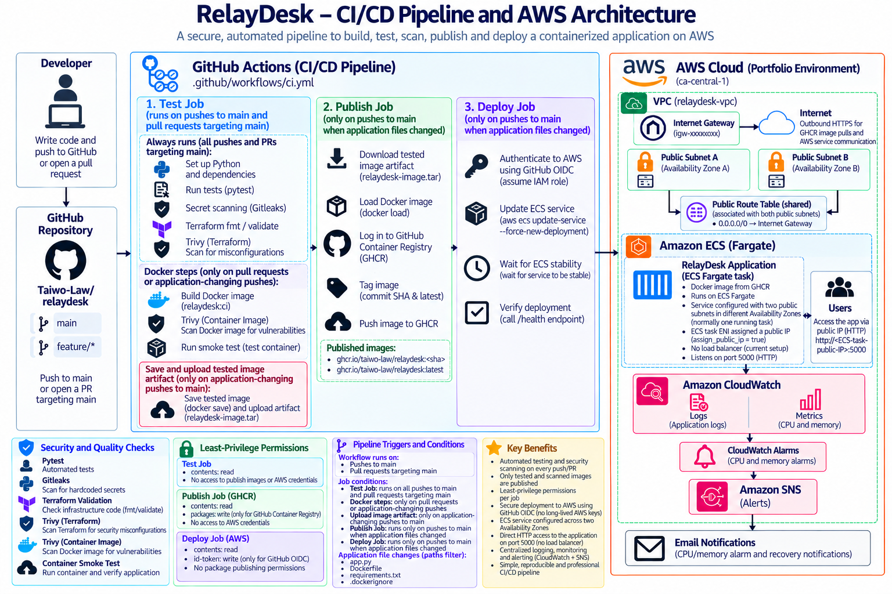

# RelayDesk

RelayDesk is a production-style Flask service built as an end-to-end DevOps portfolio project.

The project demonstrates how an application evolves from a simple locally running service into a containerized, automated, cloud-deployed, observable, and reliable production-style workload.

## Current Features

- Flask REST service
- Root application endpoint
- Health-check endpoint
- Isolated Python virtual environment
- Reproducible Python dependencies
- Git version control
- GitHub source repository
- Dockerized application
- Gunicorn production WSGI server
- Automated testing with pytest
- GitHub Actions continuous integration
- Automated Docker image builds in CI
- Container health smoke testing
- Automated container publishing to GitHub Container Registry
- Commit-SHA and `latest` Docker image tagging
- Published container pull-and-run verification
- Infrastructure provisioning with Terraform
- AWS VPC networking across multiple public subnets
- Amazon ECS deployment using AWS Fargate
- GitHub Actions authentication to AWS using OIDC
- Automated ECS deployment from GitHub Actions
- Application change detection to prevent unnecessary deployments
- Amazon CloudWatch centralized container logging
- ECS CPU and memory monitoring
- CloudWatch CPU and memory alarms
- Amazon SNS email alerting for alarm and recovery events
- ECS container health checks
- Automatic unhealthy task replacement
- Post-deployment health verification
- ECS deployment circuit breaker with rollback enabled
- Cost-conscious ECS scale-to-zero workflow
- Container image vulnerability scanning with Trivy
- Secret scanning with Gitleaks and infrastructure scanning with Trivy
- GitHub Actions guard that skips AWS deployment when the ECS desired count is zero
- Local Kubernetes Deployment, Service, namespace, and health probes
- Kubernetes scaling, self-healing, rolling updates, and rollbacks
- Kubernetes ConfigMap and demonstration Secret injection
- Flask environment-based logging configuration
- Immutable image references in Kubernetes
- Helm chart installation, configuration upgrades, and rollbacks

## API Endpoints

| Endpoint | Purpose |
|----------|---------|
| `/` | Returns RelayDesk service status |
| `/health` | Application health check |

Example health response:

```json
{
  "status": "healthy"
}
```

## Technology Stack

- Python
- Flask
- Git
- GitHub
- Docker
- Gunicorn
- pytest
- GitHub Actions
- GitHub Container Registry (GHCR)
- Terraform
- AWS
- Amazon VPC
- Amazon ECS
- AWS Fargate
- AWS IAM
- GitHub OIDC
- Amazon CloudWatch
- Amazon SNS
- Kubernetes (Docker Desktop)
- Helm
- Gitleaks
- Trivy

## AWS Architecture


RelayDesk is deployed to AWS using Terraform-managed infrastructure.

The current architecture includes:

- A dedicated Amazon VPC
- Two public subnets across multiple Availability Zones
- An Internet Gateway and public routing
- An Amazon ECS cluster
- AWS Fargate for container compute
- A dedicated ECS task security group
- A Terraform-managed ECS task definition
- A Terraform-managed ECS service
- GitHub Actions authentication to AWS through OpenID Connect (OIDC)

The ECS service uses a configurable desired task count. During development and practice sessions, the service can be scaled to zero when not in use to minimize AWS costs.

## Monitoring, Observability and Reliability

RelayDesk includes AWS-native monitoring and reliability controls.

Application and Gunicorn logs are sent from ECS to Amazon CloudWatch Logs with a seven-day retention period.

Amazon CloudWatch monitors ECS CPU and memory utilization. The current alarms are configured for:

- CPU utilization above 70% for five consecutive minutes
- Memory utilization above 80% for five consecutive minutes

Alarm and recovery events are published to Amazon SNS and delivered through a confirmed email subscription.

RelayDesk also includes:

- ECS container health checks against `/health`
- Automatic replacement of unhealthy ECS tasks
- Post-deployment health verification from GitHub Actions
- Deployment health-check timeouts
- ECS deployment circuit breaker protection
- ECS deployment circuit breaker can initiate rollback after a failed deployment; recovery must be verified

## CI/CD Pipeline

RelayDesk uses GitHub Actions for continuous integration and deployment.

The pipeline uses three jobs: **Test**, **Publish**, and **Deploy**. Tests and security checks run for pull requests; on qualifying application changes pushed to `main`, the tested image is published to GHCR and deployment is evaluated.

```text
Pull request or push
    ↓
Tests, Terraform validation and security scanning
    ↓
Docker build and smoke test (when applicable)
    ↓
Application-changing push to main?
    ├── No → No image publish or AWS deployment
    └── Yes → Publish tested image to GHCR
                    ↓
             Authenticate to AWS using GitHub OIDC
                    ↓
             Check ECS desired task count
                    ├── 0 → Skip ECS deployment
                    └── Positive → Update ECS service
                                      ↓
                              Wait for service stability
                                      ↓
                              Verify live /health endpoint
```

The deployment safeguard avoids restarting the ECS service when it has intentionally been scaled to zero.

## Security and CI/CD Safeguards

RelayDesk incorporates automated security checks, least-privilege access controls, and deployment safeguards.

### Automated Security Scanning

- **Gitleaks:** Scans Git changes for accidentally committed credentials, API keys, and other secrets. A separate full-history scan also verified the existing repository history.
- **Trivy (Terraform):** Detects HIGH and CRITICAL infrastructure security misconfigurations.
- **Trivy (Container):** Scans Docker images for HIGH and CRITICAL OS and Python dependency vulnerabilities with available fixes.
- **CI Enforcement:** Security findings covered by the configured policies cause GitHub Actions to fail before image publishing or deployment.
- **Container Hardening:** Removes pip from the final runtime image after dependency installation to reduce unnecessary software and attack surface.

### Least-Privilege CI/CD Permissions

GitHub Actions separates responsibilities into three jobs:

| Job | GitHub Permissions | Responsibility |
|-----|--------------------|----------------|
| Test | `contents: read` | Testing, validation, security scanning |
| Publish | `contents: read`, `packages: write` | Publish tested Docker images to GHCR |
| Deploy | `contents: read`, `id-token: write` | Authenticate to AWS and deploy to ECS |

The exact Docker image that passes security scanning and smoke testing is transferred to the publishing job through a short-lived GitHub Actions artifact.

AWS authentication uses GitHub OIDC and an IAM role instead of long-lived AWS access keys.

### Deployment Reliability

- ECS performs container health checks against `/health`.
- GitHub Actions waits for ECS service stability and verifies the deployed application's health.
- ECS deployment circuit breaker enables automatic rollback of failed deployments.
- CloudWatch alarms notify through SNS when CPU or memory thresholds are breached and when alarms recover.

### Documented Security Trade-offs

RelayDesk is a portfolio environment rather than a fully hardened production deployment.

- ECS tasks currently use public IPv4 addresses and expose HTTP on port 5000 without a load balancer or HTTPS termination.
- Outbound ECS traffic is limited to TCP port 443 but permits internet destinations for GHCR image pulls and AWS service communication.
- SNS server-side encryption is not enabled to avoid the recurring cost of a customer-managed KMS key.
- Accepted Terraform security exceptions are documented alongside the affected resources.

These limitations are intentionally documented and can be addressed in future architecture improvements. The ECS task definition still uses the mutable `latest` image tag, so a deployment rollback does not necessarily restore a previous image version.

## Operations Runbook

RelayDesk includes an operations runbook documenting procedures for managing, monitoring, troubleshooting, and safely shutting down the AWS environment.

The runbook covers:

- Starting the ECS Fargate service
- Verifying deployment and application health
- Investigating CloudWatch logs and metrics
- Responding to CloudWatch alarms and SNS notifications
- Troubleshooting failed ECS deployments
- Stopping ECS resources to minimize AWS costs

**[View the RelayDesk Operations Runbook](docs/OPERATIONS.md)**

## Kubernetes Deployment (Local Environment)

RelayDesk v1.0.0 has been successfully deployed to a local Kubernetes cluster using Docker Desktop.

The Kubernetes implementation demonstrates:

- Declarative deployments using Kubernetes YAML manifests
- A dedicated namespace and ClusterIP Service
- Immutable Docker image references using SHA-256 digests
- Readiness and liveness health probes
- CPU and memory resource requests and limits
- Horizontal scaling from one to three Pods
- Automatic Pod replacement and self-healing
- Rolling updates and deployment rollbacks
- Application health verification after rollback

The current Kubernetes environment uses a single local node. AWS EKS deployment is planned for a future phase.

**[View Kubernetes Deployment Documentation](docs/KUBERNETES.md)**

## Helm Deployment and Release Management

RelayDesk v1.0.0 is packaged as a reusable Helm chart for Kubernetes deployment.

The Helm implementation demonstrates:

- Helm chart development using reusable Kubernetes templates
- Configurable deployments through `values.yaml`
- Immutable GHCR container image references
- Kubernetes Deployment, Service, ConfigMap, and ServiceAccount management
- Secure references to externally created Kubernetes Secrets
- Readiness and liveness probes
- CPU and memory resource management
- ServiceAccount token automount disabled
- Automatic Pod rolling updates using ConfigMap checksum annotations
- Helm release installation, upgrades, revision history, and rollbacks

**Validated Helm release lifecycle:**

| Revision | Operation | Result |
|---|---|---|
| 1 | Initial installation with INFO logging | Successful |
| 2 | Upgrade to DEBUG logging | Successful |
| 3 | Rollback to INFO logging | Successful |

The implementation was tested on a local Docker Desktop Kubernetes cluster in the isolated `relaydesk-helm-test` namespace.

**[View Helm Chart](helm/relaydesk/)**

**[View Helm Deployment Documentation](docs/HELM.md)**

## Planned Improvements

RelayDesk currently demonstrates AWS infrastructure automation, CI/CD, containerization, Kubernetes orchestration, Helm release management, security scanning, and monitoring.

The following improvements are planned to further develop the platform:

- **Automated Helm Validation:** Integrate Helm linting and template validation into GitHub Actions.
- **Kubernetes CI/CD:** Automate Kubernetes deployments using GitHub Actions and Helm.
- **Advanced Observability:** Implement Prometheus, Grafana dashboards, and application-level metrics.
- **Production-Grade Secrets Management:** Explore AWS Secrets Manager, External Secrets Operator, and secure credential rotation.
- **Infrastructure Security:** Expand Terraform security scanning, Kubernetes security policies, and container hardening.
- **Advanced Deployment Strategies:** Implement blue-green and canary deployments with automated rollback.
- **Cloud-Native Kubernetes:** Explore Amazon EKS, multi-node infrastructure, and Kubernetes autoscaling.
- **Application Enhancements:** Expand RelayDesk beyond its initial health-check and status endpoints to demonstrate more realistic application workloads.

## Running Locally

Install the application dependencies:

```bash
pip install -r requirements.txt
```

Run the application:

```bash
python app.py
```

The service will be available at:

```text
http://127.0.0.1:5000
```

Health check:

```text
http://127.0.0.1:5000/health
```

## Project Goal

The goal of RelayDesk is to demonstrate practical DevOps and SRE skills through the complete application lifecycle, including development, containerization, CI/CD, infrastructure provisioning, cloud deployment, monitoring, security, and reliability improvements.

## Project Status

Work in progress. Additional DevOps capabilities will be introduced incrementally as the project evolves.
